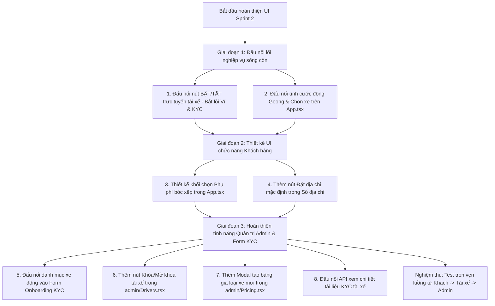

# KẾ HOẠCH HOÀN THIỆN & ĐẤU NỐI GIAO DIỆN (UI) SPRINT 2
**Dự án:** Ứng dụng Đặt Xe Tải (Truck Booking App)  
**Phạm vi:** Sprint 2 (Khách hàng, Tài xế KYC/Status, Pricing Engine Goong, Quản trị Admin)  
**Mục tiêu:** Đồng bộ 100% các API Backend đã hoàn thành vào giao diện người dùng (Customer, Driver, Admin).

---

## I. TỔNG QUAN HIỆN TRẠNG

- **Backend Sprint 2:** 100% hoàn thành, tất cả logic nghiệp vụ (tính cước, phụ phí theo múi giờ VN, Goong routing đa điểm, xác thực tài liệu KYC, kiểm tra ký quỹ 200k, phân trang tìm kiếm) đã pass toàn bộ test suite.
- **Frontend UI:** Giao diện đã có khung sườn rất đẹp và hiện đại, tuy nhiên một số nơi đang sử dụng **dữ liệu tĩnh (hardcode)** hoặc **state cục bộ (mock useState)** mà chưa gọi API thực tế; một số tính năng phụ trợ chưa có nút bấm hoặc modal để người dùng thao tác.

---

## II. PHẦN 1: GIAO DIỆN ĐÃ CÓ — CẦN ĐẤU NỐI API (UI WIRING)
*(Các màn hình đã thiết kế giao diện hoàn chỉnh, chỉ cần thay thế mock state bằng API fetch và xử lý phản hồi từ server)*

### 1. Nút công tắc Bật / Tắt nhận cuốc tài xế (Driver Online Status Switch)
* **File giao diện:** [`src/Driver.tsx`](file:///d:/WEB/App_Dat_Xe_Tai/src/Driver.tsx#L2085-L2155)
* **API Backend:** `PATCH /api/v1/driver/status` (Body: `{ isOnline: boolean }`)
* **Hiện trạng UI:** 
  - Đã có nút công tắc xoay/gạt `d-power-toggle` ("BẬT/TẮT NHẬN CUỐC") và thanh radar quét sóng tìm đơn khi online.
  - Tuy nhiên hàm `toggleOnline()` chỉ cập nhật `setOnline((o) => !o)` trong bộ nhớ React, không hề gọi API server.
* **Công việc thực hiện:**
  - Viết hàm gọi `PATCH /api/v1/driver/status` kèm Bearer token của tài xế.
  - Xử lý các mã lỗi nghiệp vụ trả về từ Server:
    - Nếu tài xế chưa được duyệt KYC (`KYC_NOT_APPROVED`): Hiển thị thông báo "Hồ sơ của bạn đang chờ quản trị viên duyệt".
    - Nếu tài xế không đủ tiền ví ký quỹ (`REQUIRE_WALLET_DEPOSIT`): Hiển thị modal/thông báo "Số dư ví ký quỹ của bạn hiện tại là X đ, cần tối thiểu 200.000đ để bật trực tuyến".
  - Khi bật thành công: Đồng bộ trạng thái online với hệ thống và bắt đầu nhận cuốc.
* **Tác dụng:** Đảm bảo tài xế chỉ có thể nhận đơn khi đã đủ điều kiện pháp lý (KYC) và tài chính (ký quỹ bảo đảm), đồng thời hệ thống dispatch biết chính xác tài xế nào đang sẵn sàng trên bản đồ.

---

### 2. Form Onboarding chọn loại xe chạy của tài xế (Vehicle Types Selector in KYC)
* **File giao diện:** [`src/Driver.tsx`](file:///d:/WEB/App_Dat_Xe_Tai/src/Driver.tsx#L1070-L1101)
* **API Backend:** 
  - `GET /api/v1/driver/vehicle-types` (Lấy danh mục loại xe từ DB)
  - `POST /api/v1/driver/kyc/submit` (Nộp hồ sơ KYC kèm `vehicleTypeId`)
* **Hiện trạng UI:** 
  - Bước 4 trong Onboarding đã có giao diện lưới chọn loại xe (`d-vehicle-grid`), nhưng danh sách xe đang hardcode tĩnh (`vehicleChoices`).
  - Khi bấm nộp hồ sơ KYC ở bước cuối, UI chưa gửi trường `vehicleTypeId`.
* **Công việc thực hiện:**
  - Trong `useEffect` của màn Onboarding, gọi `GET /api/v1/driver/vehicle-types` để hiển thị danh sách các loại xe tải thực tế đang kích hoạt trong hệ thống.
  - Lưu `vehicleTypeId` được chọn và gửi kèm vào payload của `POST /api/v1/driver/kyc/submit`.
* **Tác dụng:** Đảm bảo tài xế đăng ký đúng phân khúc xe có trong hệ thống (xe van, xe 500kg, 1 tấn...), giúp hệ thống phân bổ đơn hàng chính xác theo tải trọng xe.

---

### 3. Bộ chọn xe & Tính giá cước hành trình khách hàng (Customer Pricing & Vehicle Estimate)
* **File giao diện:** [`src/App.tsx`](file:///d:/WEB/App_Dat_Xe_Tai/src/App.tsx#L253-L428)
* **API Backend:** 
  - `GET /api/v1/pricing/rules` (Lấy danh sách các loại xe và bảng giá)
  - `POST /api/v1/pricing/estimate` (Tính giá cước dự tính Goong.io)
* **Hiện trạng UI:** 
  - Khách hàng đã có thanh nhập điểm lấy hàng, điểm giao hàng và thanh trượt chọn loại xe (`VehicleSelector`).
  - Tuy nhiên giá hiển thị cố định cứng: 89.000đ, 149.000đ, 189.000đ, 259.000đ bất kể khách đi gần hay xa.
  - Nút "Đặt xe" (`handleBook`) chỉ chuyển phase `"searching"` mà không có dữ liệu báo giá thực.
* **Công việc thực hiện:**
  - Gọi `GET /api/v1/pricing/rules` để tải danh mục xe tải động từ server.
  - Mỗi khi khách hàng chọn điểm đón và điểm trả (hoặc thêm điểm dừng trung gian): Gửi tọa độ lên `POST /api/v1/pricing/estimate`.
  - Cập nhật số km thực tế (Goong Directions), thời gian di chuyển dự kiến và giá cước tính toán theo từng loại xe trên giao diện `VehicleSelector`.
* **Tác dụng:** Khách hàng biết chính xác quãng đường thực tế, thời gian giao hàng và giá cước minh bạch theo từng loại xe trước khi bấm đặt xe; loại bỏ hoàn toàn giá ảo hardcode.

---

### 4. Xem chi tiết hồ sơ tài xế trong trang Admin (Admin Driver KYC Detail)
* **File giao diện:** [`src/admin/Drivers.tsx`](file:///d:/WEB/App_Dat_Xe_Tai/src/admin/Drivers.tsx#L380-L438)
* **API Backend:** `GET /api/admin/drivers/:id`
* **Hiện trạng UI:** 
  - Giao diện duyệt hồ sơ (`tab === "review"`) đang hiển thị thông tin lấy từ danh sách tóm tắt `GET /api/admin/drivers?kycStatus=PENDING`.
* **Công việc thực hiện:**
  - Khi Admin nhấp chọn 1 tài xế trong danh sách: Gọi `GET /api/admin/drivers/:id` để tải toàn bộ hồ sơ chi tiết (gồm 4-5 ảnh tài liệu gốc chất lượng cao từ Cloudinary, số CCCD, hạng bằng lái, biển số xe, thông tin ví ký quỹ).
* **Tác dụng:** Admin soi kỹ từng ảnh chụp giấy tờ gốc và thông tin xe trước khi quyết định bấm "Phê duyệt" hoặc "Từ chối".

---

## III. PHẦN 2: GIAO DIỆN CHƯA CÓ — CẦN THIẾT KẾ MỚI & ĐẤU NỐI (NEW UI DESIGN)
*(Các tính năng Backend đã có API sẵn sàng nhưng Frontend chưa có giao diện hoặc nút thao tác)*

### 5. Bộ chọn Phụ phí / Dịch vụ bốc xếp cho Khách hàng (Surcharge & Extra Services UI)
* **File giao diện:** Thiết kế mới tích hợp vào [`src/App.tsx`](file:///d:/WEB/App_Dat_Xe_Tai/src/App.tsx)
* **API Backend:** 
  - `GET /api/v1/pricing/services` (Lấy danh mục phụ phí: Bốc xếp 1 đầu, 2 đầu, gác lầu, bốc vác nặng...)
  - `POST /api/v1/pricing/estimate` (Gửi mảng `services` để tính tổng tiền)
* **Thiết kế đề xuất (UX/UI):**
  - Thêm một khối collapsible hoặc Bottom Sheet mang tên **"Dịch vụ kèm theo"** ngay dưới phần chọn loại xe.
  - Mỗi dịch vụ hiển thị dạng thẻ hoặc checkbox đẹp mắt:
    - Icon dịch vụ (Bốc xếp, gác lầu, người phụ vác...)
    - Tên dịch vụ & Mô tả ngắn (VD: *Tài xế phụ bốc hàng 1 đầu xe*)
    - Đơn giá niêm yết (VD: *+50.000đ*)
    - Bộ đếm số lượng (Stepper `- 1 +`) đối với các dịch vụ tính theo số tầng/người.
  - Huy hiệu thông báo tự động (Auto Badge): Nếu đặt xe trong khung giờ 22:00 - 06:00, tự động gắn nhãn "🌙 Phụ phí ban đêm (+X%)".
* **Tác dụng:** Cho phép khách hàng chủ động chọn các yêu cầu đặc thù (chuyển nhà, bốc vác, giao lên tầng cao), hệ thống tự động cộng dồn vào giá cước dự tính một cách rõ ràng, tránh cãi vã tiền bốc xếp giữa khách và tài xế ngoài thực tế.

---

### 6. Nút "Đặt làm địa chỉ mặc định" trong Sổ địa chỉ (Set Default Address Action)
* **File giao diện:** Bổ sung vào [`src/account.tsx`](file:///d:/WEB/App_Dat_Xe_Tai/src/account.tsx#L1645-L1725)
* **API Backend:** `PATCH /api/v1/customer/addresses/:id/default`
* **Thiết kế đề xuất (UX/UI):**
  - Trên mỗi thẻ địa chỉ trong Sổ địa chỉ:
    - Nếu là địa chỉ mặc định: Hiển thị Badge xanh nổi bật **[Mặc định]**.
    - Nếu chưa phải mặc định: Hiển thị nút bấm nhỏ / nút gạt **"Đặt làm mặc định"**.
  - Khi người dùng bấm nút: Gửi request `PATCH /api/v1/customer/addresses/:id/default`, cập nhật UI tức thì và hiện toast thông báo.
* **Tác dụng:** Giúp khách hàng chọn trước địa chỉ nhà riêng hoặc kho hàng quen thuộc; mỗi lần mở app đặt xe, hệ thống sẽ tự động điền sẵn địa chỉ mặc định này làm điểm lấy hàng mà không cần gõ lại.

---

### 7. Nút Khóa / Mở khóa tài xế trong trang Quản trị Admin (Driver Block/Activate UI)
* **File giao diện:** Bổ sung vào [`src/admin/Drivers.tsx`](file:///d:/WEB/App_Dat_Xe_Tai/src/admin/Drivers.tsx#L760-L830)
* **API Backend:** `PATCH /api/admin/drivers/:id/status` (Body: `{ isActive: boolean }`)
* **Thiết kế đề xuất (UX/UI):**
  - Trong bảng danh sách tài xế (Tab "Toàn bộ tài xế"):
    - Cột "Thao tác" (Actions) thêm nút Menu 3 chấm hoặc nút bấm trực tiếp:
      - Nếu tài xế đang hoạt động (`isActive = true`): Nút màu đỏ **"Khóa tài khoản"**. Bấm vào hiện popup xác nhận lý do khóa.
      - Nếu tài xế đang bị khóa (`isActive = false`): Nút màu xanh **"Mở khóa tài khoản"**.
  - Gọi API `PATCH /api/admin/drivers/:id/status` và cập nhật lại trạng thái badge của tài xế.
* **Tác dụng:** Cho phép Admin xử lý kịp thời các tài xế vi phạm quy chế (gian lận, thái độ xấu, bị khách hàng khiếu nại) bằng cách tạm ngưng quyền nhận cuốc trên hệ thống.

---

### 8. Modal Thêm bảng giá cho loại xe tải mới (Create Vehicle Pricing Rule Modal)
* **File giao diện:** Bổ sung vào [`src/admin/Pricing.tsx`](file:///d:/WEB/App_Dat_Xe_Tai/src/admin/Pricing.tsx#L680-L720)
* **API Backend:** `POST /api/admin/pricing/rules`
* **Thiết kế đề xuất (UX/UI):**
  - Thêm nút màu xanh **"+ Thêm bảng giá loại xe"** ở góc trên danh sách bảng giá xe (cạnh nút "Thêm phụ phí").
  - Mở Modal Form gồm các trường:
    - Chọn loại xe (Dropdown danh sách xe tải hệ thống hỗ trợ)
    - Tên hiển thị (VD: *Xe tải 2 tấn thùng bạt*)
    - Cự ly mở cửa (km) & Giá mở cửa (VND)
    - Đơn giá các km tiếp theo (VND/km)
    - Phí chờ theo giờ (VND/giờ)
  - Khi bấm "Lưu bảng giá": Gửi `POST /api/admin/pricing/rules` và reload danh sách.
* **Tác dụng:** Giúp doanh nghiệp dễ dàng mở rộng danh mục phương tiện (thêm xe bán tải, xe tải 2.5 tấn, xe cẩu tự hành...) và thiết lập biểu phí linh hoạt trực tiếp từ giao diện quản trị mà không cần can thiệp code hay database thủ công.

---

## IV. LỘ TRÌNH THỰC HIỆN THEO THỨ TỰ ƯU TIÊN

---

## V. TIÊU CHÍ NGHIỆM THU (ACCEPTANCE CRITERIA)

1. **Khách hàng:**
   - [ ] Nhập điểm đón & điểm đến -> Tự động tính khoảng cách km và hiển thị giá cước khác nhau theo từng loại xe.
   - [ ] Có thể tích chọn phụ phí (Bốc xếp, gác lầu) -> Tổng giá cước nhảy số cập nhật tương ứng.
   - [ ] Trong sổ địa chỉ, có thể bấm "Đặt làm mặc định" và app tự nhớ địa chỉ này cho các chuyến sau.
2. **Tài xế:**
   - [ ] Bấm "BẬT NHẬN CUỐC" khi ví < 200.000đ hoặc chưa duyệt KYC -> App bật thông báo từ chối đúng quy định.
   - [ ] Bấm "BẬT NHẬN CUỐC" khi đủ điều kiện -> Gọi API thành công, chuyển sang trạng thái sẵn sàng đón khách.
   - [ ] Khi nộp hồ sơ KYC -> Tải danh mục loại xe thực tế từ server.
3. **Quản trị viên (Admin):**
   - [ ] Có thể xem chi tiết tất cả tài liệu, giấy tờ của tài xế trước khi duyệt.
   - [ ] Có thể bấm Khóa hoặc Mở khóa tài khoản tài xế trực tiếp trên bảng điều khiển.
   - [ ] Có thể thêm mới và chỉnh sửa biểu phí của bất kỳ loại xe nào từ giao diện web.
