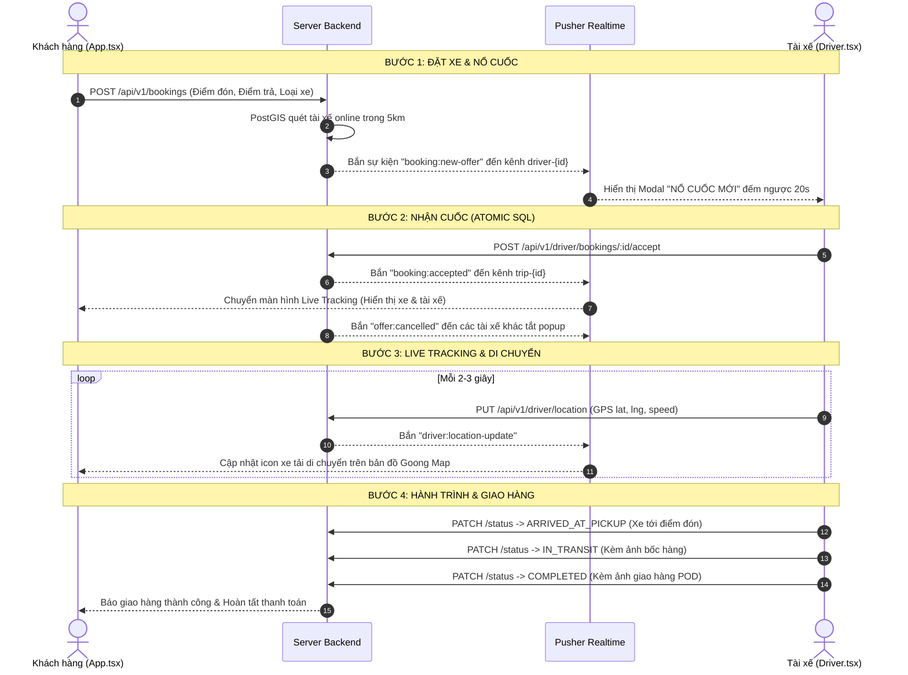

# KẾ HOẠCH HOÀN THIỆN & ĐẤU NỐI GIAO DIỆN (UI) SPRINT 3
**Dự án:** Ứng dụng Đặt Xe Tải (Truck Booking App)  
**Phạm vi:** Sprint 3 (Real-time, Điều phối cuốc xe, Live Tracking, State Machine, Pusher)  
**Mục tiêu:** Đồng bộ 100% các API Backend Sprint 3 vào giao diện Khách hàng (`App.tsx`) và Tài xế (`Driver.tsx`), thay thế hoàn toàn các hàm mock `setTimeout` giả lập.

---

## I. TỔNG QUAN HIỆN TRẠNG

- **Backend Sprint 3:** 100% hoàn thành và đã pass toàn bộ test suite:
  - PostGIS quét tài xế theo bán kính 3-5km (lọc ví >= 200k, loại trừ tài xế đang bận `ARRIVED_AT_PICKUP`).
  - Pusher Realtime bắn cuốc và xử lý nhận cuốc Atomic SQL (chống giành đơn 409).
  - State Machine chuyển trạng thái tuần tự và lưu ảnh bằng chứng giao nhận (POD).
  - Lưu vết hủy đơn vào DB và tự động tính phí bồi thường 30.000đ cho tài xế.
  - Điều phối mở rộng Vòng 2 lên 8km và bảo mật Private Channel.
- **Frontend UI:**
  - Khung giao diện của Khách hàng (`App.tsx`) và Tài xế (`Driver.tsx`) rất đẹp và mượt mà.
  - Tuy nhiên, luồng đặt xe và theo dõi hành trình hiện đang dùng **code giả lập thời gian (`PHASE_DELAY` + `setTimeout`)** và **tọa độ xe ảo (`DRIVER_PROGRESS`)** mà chưa gọi API máy chủ.
  - Phía tài xế chưa có **Modal Popup "Nổ cuốc mới" đếm ngược 20s** và chưa có **GPS Background Worker** để tự động đẩy tọa độ lên bản đồ.

---

## II. PHẦN 1: GIAO DIỆN ĐÃ CÓ — CẦN ĐẤU NỐI API THỰC TẾ (UI WIRING)
*(Thay thế state cục bộ và code giả lập bằng API fetch và WebSocket/Pusher)*

### 1. Đấu nối luồng Khách hàng Đặt xe thực tế (`POST /api/v1/bookings`)
* **File giao diện:** [`src/App.tsx`](file:///d:/WEB/App_Dat_Xe_Tai/src/App.tsx#L2534-L2555) (`handleBook`)
* **API Backend:** `POST /api/v1/bookings`
* **Hiện trạng UI:** 
  - Đã có Form chọn điểm đón, điểm trả, xe, dịch vụ bốc xếp và nút "Đặt xe".
  - Nhưng hàm `handleBook()` chỉ gọi `setPhase("searching")` trong bộ nhớ React, chưa gửi thông tin đơn hàng lên server.
* **Công việc thực hiện:**
  - Khi khách bấm "Đặt xe": Gửi payload `{ originAddress, originLat, originLng, destinationAddress, destLat, destLng, vehicleTypeId, estimatedPrice, paymentMethod }`.
  - Nhận về `bookingId`, `bookingCode`, số lượng tài xế quét được (`matchedDriversCount`).
  - Lưu `bookingId` vào state và bắt đầu lắng nghe tín hiệu phản hồi từ tài xế.
* **Tác dụng:** Chuyến xe được ghi nhận chính thức vào Database và kích hoạt hệ thống PostGIS tự động tìm tài xế gần nhất.

---

### 2. Đấu nối Màn hình Live Tracking thực tế (`GET /api/v1/bookings/:id/track`)
* **File giao diện:** [`src/App.tsx`](file:///d:/WEB/App_Dat_Xe_Tai/src/App.tsx#L810-L855)
* **API Backend:** `GET /api/v1/bookings/:id/track` và sự kiện Pusher `driver:location-update`
* **Hiện trạng UI:** 
  - Màn hình bản đồ theo dõi xe hiện đang chạy bằng timer `setTimeout` và tọa độ nội suy giả lập (`DRIVER_PROGRESS`).
* **Công việc thực hiện:**
  - Thay thế timer giả lập bằng việc fetch API `/track` hoặc lắng nghe sự kiện Pusher `driver:location-update` trên kênh `trip-{bookingId}`.
  - Hiển thị thông tin tài xế thực tế nhận đơn: Họ tên, SĐT, Biển số xe, Ảnh đại diện, Đánh giá sao.
  - Cập nhật vị trí icon chiếc xe tải di chuyển theo đúng tọa độ GPS thực tế của tài xế.
  - Cập nhật trạng thái từng chặng: [Đã nhận đơn] ➔ [Tài xế đã đến điểm lấy] ➔ [Đang vận chuyển] ➔ [Giao hàng thành công].
* **Tác dụng:** Khách hàng theo dõi vị trí xe tải chạy thời gian thực trên bản đồ một cách chân thực và chính xác 100%.

---

### 3. Đấu nối Lịch sử chuyến đi khách hàng (`GET /api/v1/bookings`)
* **File giao diện:** [`src/account.tsx`](file:///d:/WEB/App_Dat_Xe_Tai/src/account.tsx) (Tab "Đơn hàng" & `OrderHistoryModal`)
* **API Backend:** `GET /api/v1/bookings`
* **Hiện trạng UI:** 
  - Danh sách đơn hàng trong tài khoản khách đang đọc từ mảng dữ liệu tĩnh `mockBookings`.
* **Công việc thực hiện:**
  - Trong `useEffect` của tab Đơn hàng: Gọi `GET /api/v1/bookings` để tải danh sách các chuyến đi thực tế từ Database.
  - Hiển thị đúng mã cuốc (`bookingCode`), ngày giờ, điểm đón/trả, tổng tiền, trạng thái (`COMPLETED`, `CANCELLED`...).
* **Tác dụng:** Khách hàng tra cứu minh bạch toàn bộ các chuyến xe đã đặt, hóa đơn và lịch sử di chuyển.

---

### 4. Đấu nối Nút "Hủy đơn" của Khách hàng (`POST /api/v1/bookings/:id/cancel`)
* **File giao diện:** [`src/App.tsx`](file:///d:/WEB/App_Dat_Xe_Tai/src/App.tsx#L2563) (`handleCancel`)
* **API Backend:** `POST /api/v1/bookings/:id/cancel`
* **Hiện trạng UI:** 
  - Bấm "Hủy đơn" chỉ set state `setPhase("booking")` về ban đầu trong React.
* **Công việc thực hiện:**
  - Mở Popup xác nhận hủy đơn kèm lựa chọn lý do hủy (Đổi kế hoạch, Đặt nhầm địa chỉ, Chờ quá lâu...).
  - Gửi request `POST /api/v1/bookings/:id/cancel` kèm `{ reason }`.
  - Hiển thị thông báo rõ ràng (nếu hủy khi tài xế đã đến điểm đón sẽ thông báo trừ phí bồi thường 30.000đ).
* **Tác dụng:** Đồng bộ trạng thái hủy cuốc về Database, thông báo tức thì cho tài xế để dừng di chuyển.

---

### 5. Đấu nối Nút chuyển trạng thái hành trình Tài xế (`PATCH /api/v1/driver/bookings/:id/status`)
* **File giao diện:** [`src/Driver.tsx`](file:///d:/WEB/App_Dat_Xe_Tai/src/Driver.tsx#L1960-L2020)
* **API Backend:** `PATCH /api/v1/driver/bookings/:bookingId/status`
* **Hiện trạng UI:** 
  - Thẻ nhận đơn của tài xế đã có các bước hành trình nhưng chỉ đổi state trong bộ nhớ component.
* **Công việc thực hiện:**
  - Nút 1: **"ĐÃ ĐẾN ĐIỂM ĐÓN"** ➔ Gửi `{ status: "ARRIVED_AT_PICKUP" }`.
  - Nút 2: **"BẮT ĐẦU VẬN CHUYỂN"** ➔ Cho phép chụp/chọn ảnh kiện hàng bốc lên xe (`pickupProofImage`) ➔ Gửi `{ status: "IN_TRANSIT", proofImageUrl }`.
  - Nút 3: **"GIAO HÀNG THÀNH CÔNG"** ➔ Cho phép chụp ảnh giao hàng tại điểm đích (`deliveryProofImage`) ➔ Gửi `{ status: "COMPLETED", proofImageUrl }`.
* **Tác dụng:** Tuân thủ quy trình vận tải chuẩn mực, tự động chốt thanh toán PAID và lưu ảnh chứng từ giao nhận chống khiếu nại.

---

### 6. Khôi phục chuyến xe đang chạy khi mở App Tài xế (`GET /api/v1/driver/bookings/active`)
* **File giao diện:** [`src/Driver.tsx`](file:///d:/WEB/App_Dat_Xe_Tai/src/Driver.tsx)
* **API Backend:** `GET /api/v1/driver/bookings/active`
* **Công việc thực hiện:**
  - Mỗi khi tài xế vào trang điều hành hoặc F5 tải lại trang: Tự động gọi `GET /api/v1/driver/bookings/active`.
  - Nếu có cuốc đang chạy: Tự động khôi phục giao diện điều hướng chuyến đi, thông tin khách hàng và vị trí giao hàng.
* **Tác dụng:** Tránh việc tài xế bị mất màn hình cuốc xe khi rớt mạng hoặc vô tình đóng ứng dụng.

---

## III. PHẦN 2: GIAO DIỆN CHƯA CÓ — CẦN THIẾT KẾ MỚI & ĐẤU NỐI (NEW UI DESIGN)
*(Thiết kế mới các thành phần quan trọng còn thiếu)*

### 7. Thiết kế Modal Popup "Cuốc xe mới" đếm ngược 20s cho Tài xế
* **File giao diện:** Thiết kế mới tích hợp vào [`src/Driver.tsx`](file:///d:/WEB/App_Dat_Xe_Tai/src/Driver.tsx)
* **API Backend:** `POST /api/v1/driver/bookings/:bookingId/accept`
* **Thiết kế đề xuất (UX/UI):**
  - Khi có sự kiện nổ cuốc (`booking:new-offer`):
    - Phát chuông âm thanh thông báo và bật Modal Popup tràn viền nổi bật.
    - Hiển thị thẻ tóm tắt cuốc xe:
      - Loại xe yêu cầu (VD: *Xe tải 500kg*)
      - Điểm lấy hàng & Điểm giao hàng
      - Cự ly vận chuyển (VD: *5.6 km*)
      - **Cước phí thực nhận (VND)** to bản màu cam/xanh
    - Thanh tiến trình đếm ngược 20 giây màu đỏ co dần.
    - Hai nút thao tác:
      - Nút xám: "Bỏ qua"
      - Nút xanh lớn: **"NHẬN CUỐC NGAY"**
  - Khi bấm "Nhận cuốc": Gọi `POST /api/v1/driver/bookings/:bookingId/accept`.
    - Nếu thành công: Đóng popup, chuyển sang màn hình điều hướng đơn hàng.
    - Nếu trễ hơn tài xế khác (lỗi 409): Hiện toast thông báo "Rất tiếc! Đơn đã có tài xế khác nhanh tay tiếp nhận".
* **Tác dụng:** Trải nghiệm "nổ cuốc" trực quan, sinh động giống 100% ứng dụng tài xế công nghệ hàng đầu (Grab, Lalamove).

---

### 8. Thiết kế Worker GPS Background tự động phát sóng vị trí Tài xế
* **File giao diện:** Viết module chạy ngầm trong [`src/Driver.tsx`](file:///d:/WEB/App_Dat_Xe_Tai/src/Driver.tsx)
* **API Backend:** `PUT /api/v1/driver/location`
* **Thiết kế đề xuất (UX/UI):**
  - Khi tài xế gạt công tắc **"BẬT TRỰC TUYẾN"** hoặc đang trong chuyến đi (`status !== 'COMPLETED'`):
    - Kích hoạt `navigator.geolocation.watchPosition` (hoặc chu kỳ 3 giây gửi 1 lần).
    - Gửi tọa độ `{ lat, lng, heading, speed }` lên `PUT /api/v1/driver/location`.
  - Hiển thị chấm xanh nhấp nháy trên thanh header tài xế: *"GPS đang hoạt động"*.
* **Tác dụng:** Đảm bảo hệ thống luôn nắm bắt vị trí thực tế của xe tải để phát cuốc và truyền Live Tracking cho khách hàng.

---

### 9. Thiết kế Nút "Mở rộng bán kính tìm xe (8km)" cho Khách hàng
* **File giao diện:** Bổ sung vào màn hình radar tìm xe trong [`src/App.tsx`](file:///d:/WEB/App_Dat_Xe_Tai/src/App.tsx)
* **API Backend:** `POST /api/v1/bookings/:id/escalate`
* **Thiết kế đề xuất (UX/UI):**
  - Trong lúc màn hình radar quét xe:
    - Nếu sau 15–20 giây chưa có tài xế nhận cuốc:
    - Hiển thị nút bấm viền phát sáng: **"📡 Mở rộng bán kính tìm xe (8km)"** hoặc đếm ngược tự động kích hoạt.
    - Bấm vào sẽ gọi `POST /api/v1/bookings/:id/escalate` và cập nhật thông báo "Đang quét các xe ở xa hơn...".
* **Tác dụng:** Giúp khách hàng không bị kẹt đơn ở vùng ít xe tải, tăng tỷ lệ tìm được tài xế thành công.

---

### 10. Thiết kế Popup "Hủy nhận chuyến" cho Tài xế
* **File giao diện:** Bổ sung vào [`src/Driver.tsx`](file:///d:/WEB/App_Dat_Xe_Tai/src/Driver.tsx)
* **API Backend:** `POST /api/v1/driver/bookings/:bookingId/cancel`
* **Thiết kế đề xuất (UX/UI):**
  - Dưới thẻ chuyến xe đang chạy, thêm nút nhỏ màu đỏ: **"Báo sự cố / Hủy chuyến"**.
  - Bấm vào bật Modal chọn lý do: *Xe bị sự cố kỹ thuật*, *Không liên hệ được khách hàng*, *Kẹt xe nghiêm trọng*.
  - Gọi API hủy cuốc để giải phóng chuyến xe và trả về trạng thái tìm tài xế mới.
* **Tác dụng:** Giải quyết các sự cố bất khả kháng trên đường của tài xế một cách chuyên nghiệp.

---

## IV. SƠ ĐỒ LUỒNG ĐIỀU PHỐI REALTIME (MERMAID)

---

## V. BẢNG TỔNG HỢP TIẾN ĐỘ THI CÔNG UI SPRINT 3

| Mã Task | Hạng mục công việc UI | Giao diện | Phân loại | Thời gian |
| :---: | :--- | :---: | :---: | :---: |
| **U-3.1** | Đấu nối nút "Đặt xe" thực tế (`POST /bookings`) | Khách hàng (`App.tsx`) | UI Wiring | 2.0h |
| **U-3.2** | Đấu nối màn hình Live Tracking GPS thật | Khách hàng (`App.tsx`) | UI Wiring | 3.0h |
| **U-3.3** | Đấu nối danh sách Lịch sử chuyến đi thật | Khách hàng (`account.tsx`) | UI Wiring | 1.5h |
| **U-3.4** | Đấu nối Popup & Nút Hủy đơn của khách | Khách hàng (`App.tsx`) | UI Wiring | 1.5h |
| **U-3.5** | Nút chuyển trạng thái hành trình kèm ảnh POD | Tài xế (`Driver.tsx`) | UI Wiring | 2.5h |
| **U-3.6** | Khôi phục đơn đang chạy khi mở app | Tài xế (`Driver.tsx`) | UI Wiring | 1.0h |
| **U-3.7** | Thiết kế Modal Popup "Nổ cuốc mới" đếm ngược 20s | Tài xế (`Driver.tsx`) | Thiết kế mới | 3.0h |
| **U-3.8** | Thiết kế GPS Background Worker phát sóng vị trí | Tài xế (`Driver.tsx`) | Thiết kế mới | 2.0h |
| **U-3.9** | Thiết kế Nút mở rộng bán kính tìm xe (8km) | Khách hàng (`App.tsx`) | Thiết kế mới | 1.5h |
| **U-3.10**| Thiết kế Popup Báo sự cố / Hủy chuyến cho tài xế | Tài xế (`Driver.tsx`) | Thiết kế mới | 1.5h |
| **U-3.11**| Module Pusher Client kết nối Realtime 2 chiều | Core Lib (`pusherClient.ts`) | Core Lib | 2.0h |

**Tổng thời gian dự kiến:** ~21.5 giờ làm việc.

---

## VI. TIÊU CHÍ NGHIỆM THU (ACCEPTANCE CRITERIA)

1. **Trải nghiệm Khách hàng:**
   - [ ] Bấm "Đặt xe" -> Gửi đơn thành công lên server, nhận mã đơn hàng thực tế (VD: `BK261013-XXXX`).
   - [ ] Màn hình radar quét xe hiển thị thông tin thực; nếu sau 15s chưa có xe có thể bấm mở rộng bán kính lên 8km.
   - [ ] Khi tài xế nhận đơn -> Màn hình tự động chuyển sang Live Tracking, hiển thị đúng tên, SĐT, biển số xe tài xế.
   - [ ] Icon xe tải trên bản đồ di chuyển theo tọa độ GPS thật của tài xế.
   - [ ] Xem lại đầy đủ lịch sử chuyến xe trong tài khoản cá nhân.

2. **Trải nghiệm Tài xế:**
   - [ ] Bật "Trực tuyến" -> Hệ thống tự động theo dõi GPS ngầm.
   - [ ] Khi có khách đặt xe gần đó -> Màn hình lập tức bật Popup "Cuốc xe mới" đếm ngược 20 giây kèm âm thanh chuông báo.
   - [ ] Bấm "Nhận cuốc" -> Tiếp nhận đơn thành công, chuyển sang màn hình điều hướng lộ trình.
   - [ ] Có thể bấm cập nhật trạng thái "Đã đến điểm đón" -> "Bắt đầu giao" (chụp ảnh) -> "Giao hàng thành công" (chụp ảnh).
